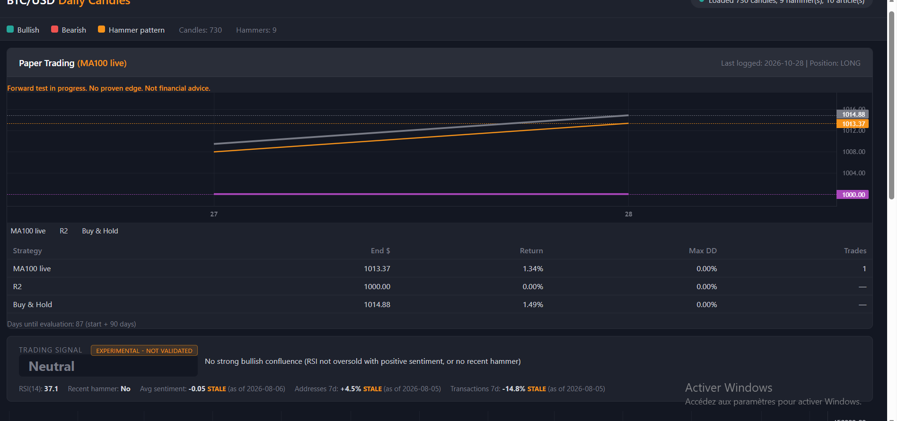

# Bitcoin Signal Lab

**Can news sentiment, on-chain data and technical indicators predict Bitcoin's next move? I built a pipeline to find out, and tested it without fooling myself.**

> **Short answer:** on ~8.7 years of daily data, none of the signals I tested showed a statistically significant edge over buy-and-hold. A simple trend filter (`close > 100-day moving average`) limited drawdowns in down markets, and it is now being validated in a live paper-trading test with frozen rules (evaluation date: **2027-01-25**).

> **Disclaimer:** research and educational project only. Not financial advice. No real money is traded. Past results do not predict future results.



---

## The idea

The starting idea: a system that reads Bitcoin news, combines it with on-chain "fundamentals" and technical indicators, and predicts whether the market goes up or down. The project turned into something more useful: a reproducible way to test whether such a signal really works, and an honest record of what I found.

## What I built

| Part | Files |
|---|---|
| Price data (Binance daily candles, 2018 → today) | `fetch_btc_data.py` |
| On-chain data (unique addresses, transactions/day; Blockchain.com) | `fetch_fundamentals.py`, `fetch_fundamentals_history.py` |
| Sentiment: live CoinDesk headlines scored with VADER; historical Fear & Greed Index as a proxy | `fetch_news.py`, `sentiment.py`, `fetch_sentiment_history.py` |
| Technical indicators: RSI(14), moving averages, hammer candlestick | `analyze.py`, `detect_hammer.py` |
| Signal combiner (technicals + sentiment + on-chain veto) | `signal_combiner.py`, `index.html` |
| Backtests and statistical tests | `backtest.py`, `backtest_full.py`, `backtest_variants.py`, `stress_test_rules.py` |
| Walk-forward machine-learning model | `model_walkforward.py` |
| Live paper trading with frozen rules | `paper_trade.py`, `paper_report.py`, `RULES_FROZEN.md`, `paper_log.csv` |
| Dashboard | `index.html` |
| Tests | `test_signal_combiner.py`, `test_signal_logic.py` |

Technical notes (script details, Windows Task Scheduler setup) are in [`docs/TECHNICAL_NOTES.md`](docs/TECHNICAL_NOTES.md).

## Method

- **No look-ahead:** signals use only information available at the close of day *t* and trade on day *t+1*.
- **Hold-out data:** the last 20% of days were kept aside from the analysis.
- **Costs included:** 0.10% fee + 0.05% slippage per side (0.30% round trip) in the stress test.
- **Significance:** block bootstrap (1,000 resamples, 20-day blocks) on the Sharpe-ratio difference vs buy-and-hold; binomial tests on up-rates.
- **Walk-forward validation:** the model is retrained on an expanding window and only predicts later data.

## Results, step by step

**1. Technical signals only (2 years of data).** RSI < 30 or a hammer candle gave 34 bullish signals. 58.8% were followed by a 3-day rise, against 53.8% for all days. That gap is within noise (z ≈ 0.6), and the average 3-day return after the signal was −0.03%.

**2. The full combined signal (technicals + sentiment + on-chain).** It fired only 6 times in 723 days (99.2% "Neutral"), too rarely to evaluate. The cause: BTC is usually oversold when market fear is high, so "RSI < 30 *and* positive sentiment" almost never happens.

**3. More data, more ideas.** I extended the data to 3,192 daily candles (2018-02-01 → 2026-10-28) and tested five trend/momentum rules and a walk-forward logistic regression. The model had **no predictive power** (AUC ≈ 0.455 in the analysis window, 0.48 on the hold-out; 0.5 is a coin flip).

**4. Stress test with costs** (figures as printed by `stress_test_rules.py`):

| Strategy (analysis window, with costs) | Sharpe | Trades |
|---|---|---|
| Buy & hold | 0.85 | – |
| R2: 7-day momentum > 0 and price > 90-day MA | 0.99 | 139 |
| `close > MA200` | 1.03 | – |
| `close > MA100` | 1.25 | 41 |

On the hold-out period (a falling market) buy-and-hold lost about 12.7% a year, R2 about 0.9%, and `close > MA100` gained about 5.9%. But **no Sharpe advantage was statistically significant**: every 95% confidence interval for the difference vs buy-and-hold included zero (for MA100: +0.36, interval −0.22 to +0.95). The rules mostly work as *drawdown reducers*: they stay in cash during crashes and lag in strong bull markets.

Because MA100 was picked after looking at the results (and its hold-out numbers were displayed), it cannot count as validated. That is why a forward test was started.

## Forward test (in progress)

- Rule frozen on the start date in [`RULES_FROZEN.md`](RULES_FROZEN.md): **MA100 long/cash** is the live rule, **R2** and **buy-and-hold** are tracked for comparison.
- A scheduled job logs one row per day in [`paper_log.csv`](paper_log.csv) (virtual $1,000, 0.15% cost per side). The commit history shows the log growing day by day.
- Evaluation date: **2027-01-25** (start + 90 days). 90 days is short, so the likely honest outcome is "inconclusive", and a longer run is needed for real conclusions.

## What I learned

- A signal made of several plausible conditions can be so strict that it almost never fires. Always count signals before judging them.
- With a few dozen events, an edge of a few percentage points is indistinguishable from luck. Confidence intervals matter more than headline returns.
- Picking the best rule among several variants and then "validating" it on the same data is a trap; forward testing is the clean answer.
- Small engineering details can silently corrupt a test: a scheduled task started in the wrong folder and could not refresh its data. The script now backfills missed days exactly, and this is covered by a test.

## Limitations

- About 8.7 years of daily data is a small sample (a handful of market cycles).
- The historical sentiment is the Fear & Greed Index, a *proxy*, not real news sentiment. On-chain data is sampled every ~4 days and forward-filled.
- One asset (BTC), daily frequency only, long/cash only.

## How to run

```bash
pip install -r requirements.txt
python fetch_btc_data.py --full         # download daily BTC candles
python fetch_fundamentals_history.py    # on-chain history
python fetch_sentiment_history.py       # Fear & Greed history
python backtest_variants.py             # rule backtests
python stress_test_rules.py             # costs, baselines, bootstrap
python paper_trade.py                   # log the latest closed day
python paper_report.py                  # forward-test summary
python -m http.server 8000              # then open http://localhost:8000/index.html
```

## Roadmap

- Evaluate the forward test on 2027-01-25 and publish the result, good or bad.
- Test real historical news sentiment instead of the Fear & Greed proxy.
- Try other assets and lower-frequency rules.

## Data sources

Every number above is produced by scripts in this repository. Data comes from public APIs (Binance, Blockchain.com, Alternative.me, CoinDesk RSS); check each provider's terms before reuse.

## License and author

MIT, see [`LICENSE`](LICENSE). Author: Yann.
